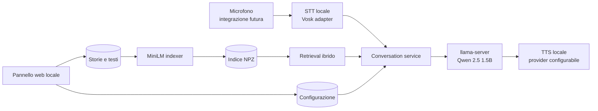

<div align="center">

# WISP

### Conversazioni e storie locali per piccoli dispositivi ARM

Un piccolo telefono, un modello locale e un progetto nato per conversare senza cloud.


</div>

> [!IMPORTANT]
> WISP è in fase alpha. Il RAG non garantisce che ogni risposta sia corretta o adatta a un bambino: il dispositivo richiede supervisione adulta.

## Perché esiste

WISP nasce da un prototipo reale costruito attorno a un RK3566 con 4 GB di RAM. L’obiettivo era semplice: creare un oggetto fisico capace di ascoltare e rispondere usando soltanto modelli locali. Il primo prototipo ha dimostrato il funzionamento di Qwen e di un RAG ibrido; questa repository trasforma quel lavoro in un sistema leggibile, configurabile e riproducibile.

Non è una demo cloud travestita da dispositivo embedded. L’inferenza, gli embedding, il reranking e i documenti restano sulla macchina.


> Screenshot del pannello: da acquisire sul dispositivo reale dopo l’installazione. La sessione di preparazione non disponeva di un browser controllabile e non viene usato un mock al suo posto.

## Cosa funziona oggi

- Qwen 2.5 tramite l’API OpenAI-compatible di `llama.cpp`.
- RAG ibrido basato su MiniLM ONNX, matching lessicale e reranker ONNX.
- Profili multipli per personaggi, prompt e voci.
- Contenuti associabili a uno o più personaggi.
- Editor e upload sicuro di file `.txt` e `.md`.
- Ricostruzione locale dell’indice.
- Interfaccia essenziale con amici, storie, voci e QR per l’accesso da telefono.
- Voci italiane Piper Paola e Riccardo, installabili dal pannello e utilizzabili offline.
- Adattatore Vosk per trascrivere file audio offline.
- Pipeline componibile ALSA → Vosk → RAG/Qwen → TTS locale → ALSA, disattivata finché hardware e voce non sono configurati.
- Pannello responsive utilizzabile da telefono o computer.

La cattura live dal microfono non è dichiarata completa: sul dispositivo analizzato non era disponibile un ingresso audio. Le voci Piper sono predisposte dal codice ma vanno installate sul dispositivo.

## Architettura



Il pannello modifica configurazione e contenuti, ma non è parte del ciclo vitale della conversazione. Chiudere il browser non arresta il motore.

## Dal prototipo reale

La base tecnica recuperata dal dispositivo comprendeva:

- `llama.cpp` build 10586, commit `b21e4de74`;
- Qwen 2.5 1.5B Instruct Q4_K_M;
- `paraphrase-multilingual-MiniLM-L12-v2` quantizzato ONNX;
- reranker derivato da `mMiniLMv2-L12-H384-distilled-from-XLMR-Large`;
- indice da 181 frammenti e 384 dimensioni;
- benchmark del retrieval: 61/69 casi noti corretti, pari all’88,4%, tempo medio 1,047 s.

I dettagli sono in [Ricognizione del dispositivo](docs/DEVICE_AUDIT.md); le differenze sono riepilogate in [Dal prototipo originale a WISP](docs/ORIGINAL_VS_WISP.md).

## Avvio rapido per sviluppo

```bash
python -m venv .venv
source .venv/bin/activate
python -m pip install -e ".[dev]"
mkdir -p data
cp config.example.json data/config.json
wisp serve
```

Su Windows, attiva l’ambiente con `.venv\Scripts\Activate.ps1`. Apri poi `http://127.0.0.1:8787`.

Il pannello parte anche quando i modelli non sono presenti; indicizzazione e chat richiedono i percorsi ONNX/GGUF configurati. Il QR usa `server.public_url`: sul dispositivo di riferimento punta a `http://192.168.0.250:8787`.

Per installare in una volta sola audio, Piper, GPIO e server di produzione puoi usare il pulsante **Installa componenti** mostrato al primo avvio, oppure:

```bash
python -m pip install -e ".[audio,hardware,production]"
```

Dal pannello **Voci** puoi installare Paola o Riccardo. Puoi anche inserire una API key ElevenLabs: WISP la verifica sul server, salva soltanto il segreto locale e mostra le voci del tuo account. Se assegni una voce ElevenLabs a un amico, la risposta viene sintetizzata tramite l’API; Piper continua invece a funzionare offline.

## Avvio su RK3566

Requisiti consigliati:

- Linux ARM64;
- 4 GB di RAM;
- Python 3.11 o successivo;
- una build ARM64 di `llama.cpp` con `llama-server`;
- circa 2 GB per modello LLM, embedding e reranker;
- memoria separata dal filesystem di sistema, se possibile.

Avvia prima il server Qwen:

```bash
/opt/llama.cpp/build/bin/llama-server \
  -m /mnt/emmc/models/qwen2.5-1.5b-instruct-q4_k_m.gguf \
  -t 4 -c 1024 --host 127.0.0.1 --port 8080
```

Poi configura `data/config.json` e avvia WISP:

```bash
WISP_CONFIG=/mnt/emmc/wisp/data/config.json /mnt/emmc/wisp/.venv/bin/wisp serve
```

Installa WISP e il suo ambiente virtuale sulla eMMC, non sulla piccola partizione di sistema osservata durante la ricognizione. Per il servizio web installa anche l’extra di produzione con `python -m pip install -e ".[production]"`. I file in `deploy/` sono esempi: configurare il mount, copiarli in systemd e abilitarli è un’operazione amministrativa intenzionalmente non automatizzata.

### Pulsante fisico

Il servizio `wisp button-service` attende un fronte GPIO. A ogni pressione ricarica la configurazione corrente ed esegue un ciclo completo: ALSA registra, Vosk trascrive, Qwen/RAG risponde e la voce selezionata viene riprodotta con Piper o ElevenLabs. Imposta prima l’offset reale del pin:

```json
"button": {
  "chip": "/dev/gpiochip0",
  "line": 5,
  "edge": "falling",
  "debounce_ms": 80
}
```

La configurazione hardware di riferimento assume un pulsante su `/dev/gpiochip0`, linea `5`, e un microfono ALSA chiamato `default`. Entrambi i valori restano modificabili per adattarsi al cablaggio definitivo. `deploy/wisp-button.service` contiene l’unità systemd di riferimento. L’utente `wisp` deve avere accesso al GPIO scelto e al gruppo audio.

## Personaggi e proprietà intellettuale

La configurazione di esempio usa il nome **Spider-Man**, come profilo testuale creato dall’utente. La repository non contiene immagini, storie, loghi, audio, modelli vocali o checkpoint ufficiali o derivati. Spider-Man è un marchio/personaggio dei rispettivi titolari; WISP non è affiliato a Marvel o Disney.

Per una distribuzione propria, configura personaggi e contenuti originali o per i quali possiedi i diritti.

## Pannello senza autenticazione

Su richiesta, questa versione non richiede login. Il server ascolta sulla LAN (`0.0.0.0`) per essere raggiungibile da smartphone. Non esporlo a Internet e usalo solo su una rete fidata. Consulta [Sicurezza e privacy](docs/SECURITY.md).

## Test

```bash
python -m pytest
```

I test coprono configurazione, persistenza, protezione dai path traversal, upload, chunking, indicizzazione, filtro per personaggio e API web.

## Struttura

```text
src/wisp/
├── audio.py            # adattatori STT/TTS
├── button.py           # ascolto del pulsante GPIO fisico
├── config.py           # configurazione validata e atomica
├── conversation.py     # orchestrazione indipendente dal web
├── diagnostics.py      # metriche reali del dispositivo
├── elevenlabs.py       # client TTS ElevenLabs
├── llm.py              # client streaming per llama.cpp
├── rag/                # embedding, indice, retrieval e reranking
├── storage.py          # documenti e upload
├── secrets.py          # segreti locali non esposti dal pannello
├── voices.py           # catalogo e installazione voci Piper
└── web/                # API e pannello responsive
```

## Limiti noti

- La pipeline live è implementata, ma non verificata sul prototipo perché non viene rilevato un ingresso audio.
- Le voci ElevenLabs restano nel relativo account e richiedono Internet, API key e crediti; non sono scaricabili dentro Piper.
- Il servizio del pulsante usa la configurazione hardware di riferimento; il collaudo elettrico finale resta necessario sul dispositivo assemblato.
- Nessuna autenticazione del pannello.
- L’indicizzazione è sincrona e può occupare la richiesta HTTP per alcuni secondi.
- Il benchmark esistente misura il retrieval del dataset privato originale e non accompagna la repository.
- Le prestazioni dipendono dalla build di ONNX Runtime e `llama.cpp` per il dispositivo.
- Il filesystem di sistema osservato sul prototipo era quasi pieno; WISP non tenta di ripulirlo automaticamente.

## Roadmap

- acquisizione ALSA con voice activity detection;
- verifica end-to-end di riproduzione e TTS Piper sull’hardware;
- indicizzazione in background con avanzamento;
- benchmark riproducibile con corpus pubblico;
- pacchetto di installazione ARM64;
- autenticazione opzionale per reti condivise.

## Licenza

Il codice WISP è distribuito sotto licenza MIT. Modelli, voci e contenuti caricati dall’utente mantengono le rispettive licenze.

