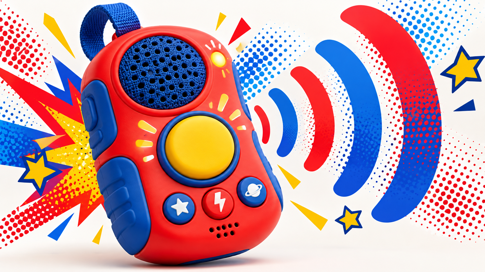
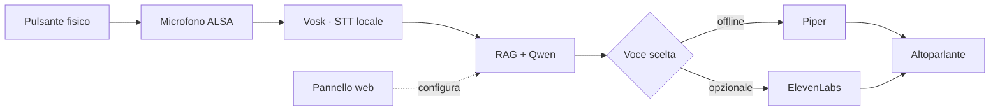

<div align="center">



# WISP

### Premi. Parla. Ascolta una storia.

Un compagno vocale **local-first** per piccoli dispositivi ARM, progettato per funzionare senza schermo e senza dipendere dal browser.

[](https://www.python.org/)
[](#hardware-di-riferimento)
[](#test)
[](LICENSE)

[Avvio rapido](#avvio-rapido) · [Come funziona](#come-funziona) · [Hardware](#hardware-di-riferimento) · [Sicurezza](docs/SECURITY.md)

</div>

> [!IMPORTANT]
> WISP è in fase **alpha**: configura amici, storie e voce dal pannello prima di affidare il dispositivo al bambino.

## Un interfono tutto suo

Il pannello web serve soltanto a scegliere amici, voci e storie. Durante l’uso quotidiano il bambino non deve aprire alcuna pagina: preme il pulsante fisico, parla e ascolta la risposta dal dispositivo.

| 1 · Premi | 2 · Parla | 3 · Ascolta |
|:---:|:---:|:---:|
| Il GPIO avvia la registrazione | Vosk trascrive localmente | Qwen risponde e Piper parla |

I documenti, il retrieval e l’inferenza possono restare interamente sul dispositivo. **ElevenLabs è opzionale**: si attiva soltanto inserendo una propria API key e richiede Internet e crediti.

## Cosa offre

- Conversazione autonoma dal pannello tramite pulsante fisico.
- Qwen 2.5 eseguito localmente con `llama.cpp`.
- RAG ibrido con MiniLM ONNX, ricerca lessicale e reranker.
- Amici con prompt, raccolte di storie e voci indipendenti.
- Voci italiane Piper, installabili e utilizzabili offline.
- Trascrizione offline tramite Vosk e acquisizione audio ALSA.
- Integrazione opzionale ElevenLabs con API key conservata localmente.
- Pannello responsive, accessibile dalla rete locale anche tramite QR code.
- Servizi `systemd` di esempio per pannello e pulsante.

## Come funziona



Il pannello modifica configurazione e contenuti, ma non fa parte del ciclo vitale della conversazione. Chiudere il browser non arresta il motore.

## Avvio rapido

### Linux e dispositivo ARM64

```bash
git clone https://github.com/mroscini/WISP.git
cd WISP
python -m venv .venv
source .venv/bin/activate
python -m pip install -e ".[dev]"
mkdir -p data
cp config.example.json data/config.json
wisp serve
```

### Windows

```powershell
git clone https://github.com/mroscini/WISP.git
cd WISP
python -m venv .venv
.venv\Scripts\Activate.ps1
python -m pip install -e ".[dev]"
Copy-Item config.example.json data/config.json
wisp serve
```

Apri `http://127.0.0.1:8787`. Sulla rete locale usa l’indirizzo mostrato dal QR code; nella configurazione di riferimento è `http://192.168.0.250:8787`.

Il pannello può partire anche senza modelli. Indicizzazione e conversazione richiedono invece i percorsi ONNX/GGUF corretti. Al primo avvio puoi installare i componenti dal pulsante **Installa componenti**, oppure eseguire:

```bash
python -m pip install -e ".[audio,hardware,production]"
```

## Hardware di riferimento

La configurazione inclusa assume:

| Componente | Valore predefinito |
|---|---|
| SoC | RK3566 ARM64 |
| Memoria | 4 GB |
| Microfono | dispositivo ALSA `default` |
| Pulsante | `/dev/gpiochip0`, linea `5` |
| Evento | fronte `falling`, debounce `80 ms` |
| Modello | Qwen 2.5 1.5B Instruct Q4_K_M |

Microfono e linea GPIO sono valori di riferimento: possono essere modificati in `data/config.json` quando il cablaggio definitivo è noto.

Avvia il modello con `llama-server`:

```bash
/opt/llama.cpp/build/bin/llama-server \
  -m /mnt/emmc/models/qwen2.5-1.5b-instruct-q4_k_m.gguf \
  -t 4 -c 1024 --host 127.0.0.1 --port 8080
```

Poi avvia pannello e servizio del pulsante:

```bash
WISP_CONFIG=/mnt/emmc/wisp/data/config.json /mnt/emmc/wisp/.venv/bin/wisp serve
WISP_CONFIG=/mnt/emmc/wisp/data/config.json /mnt/emmc/wisp/.venv/bin/wisp button-service
```

Le unità di esempio sono in [`deploy/`](deploy/). L’utente del servizio deve poter accedere al GPIO scelto e al gruppo audio.

## Voci

Nel pannello **Voci** puoi installare Paola o Riccardo per la sintesi offline con Piper. In alternativa puoi inserire una API key ElevenLabs e assegnare a ogni amico una voce disponibile nel tuo account.

La chiave viene verificata dal server, conservata nel file locale `data/.secrets.json` e mai restituita integralmente al browser. Le voci ElevenLabs rimangono nel relativo account: non vengono convertite o scaricate come modelli Piper.

## Dal prototipo reale

WISP deriva da una ricognizione su un dispositivo RK3566 reale. Il prototipo conteneva `llama.cpp`, Qwen 2.5 1.5B, embedding MiniLM e un reranker multilingue. Il retrieval originale raggiungeva 61 risposte corrette su 69 casi noti (88,4%).

- [Ricognizione tecnica del dispositivo](docs/DEVICE_AUDIT.md)
- [Dal prototipo originale a WISP](docs/ORIGINAL_VS_WISP.md)
- [Sicurezza e privacy](docs/SECURITY.md)
- [Come contribuire](CONTRIBUTING.md)

## Struttura

```text
src/wisp/
├── audio.py            # STT, TTS e ALSA
├── button.py           # pulsante GPIO fisico
├── config.py           # configurazione validata e atomica
├── conversation.py     # ciclo completo della conversazione
├── elevenlabs.py       # client TTS opzionale
├── rag/                # embedding, indice e retrieval
├── voices.py           # catalogo Piper
└── web/                # API e pannello responsive
```

## Test

```bash
python -m pytest
```

La suite copre configurazione, persistenza, sicurezza dei percorsi, upload, chunking, RAG, voci, ElevenLabs, API web e integrazione GPIO.

## Contenuti

Amici, storie e voci vengono scelti da chi configura il dispositivo. La repository distribuisce il motore WISP, non raccolte di contenuti o modelli di terze parti.

## Licenza

Il codice è distribuito sotto licenza [MIT](LICENSE). Modelli, voci e contenuti caricati dall’utente mantengono le rispettive licenze.

<div align="center">

**WISP** · piccolo, locale, curioso

</div>
